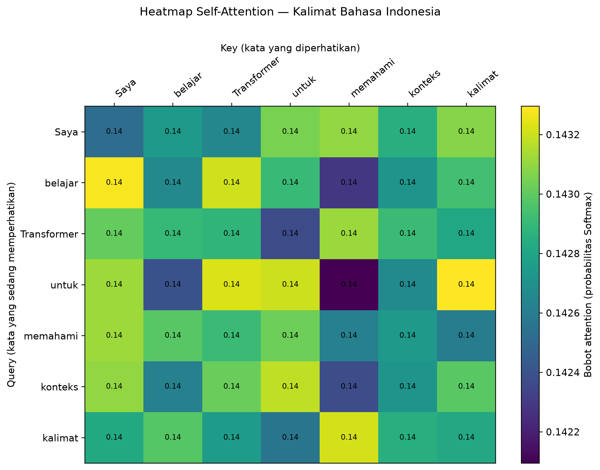

# tugas_transformer_kecerdasan_buatan

Praktikum Pekan 5 — Transformer & Self-Attention
- **Nama**: Fairuz Istighfar
- **NIM**: 60900124044
- **Mata Kuliah**: Kecerdasan Buatan

---

## 📌 Deskripsi

Repositori ini berisi implementasi dan demonstrasi matematis mekanisme **Self-Attention** dan **Causal Masking** pada arsitektur Transformer menggunakan Python (NumPy & Matplotlib).

Pada demonstrasi ini:
- Menggunakan kalimat: Saya belajar Transformer untuk memahami konteks kalimat (7 token).
- Embedding sintetis acak berdimensi d_model = 8.
- Matriks bobot proyeksi W_Q, W_K, W_V berdimensi (8, 8).
- Menghitung Scaled Dot-Product Attention:
  Attention(Q, K, V) = softmax(Q K^T / sqrt(d_k)) V
- Menghasilkan visualisasi matriks attention weights berupa heatmap.
- Menerapkan causal mask (triangular upper mask) untuk menyembunyikan token masa depan.

---

## 🚀 Hasil Eksekusi Kode (lab_pekan_05_transformer_fairuz.py)

`	ext
Kalimat: Saya belajar Transformer untuk memahami konteks kalimat
Bentuk Q, K, V: (7, 8) (7, 8) (7, 8)
Bobot attention untuk setiap query:
Saya         paling besar memperhatikan memahami    : 0.1431
belajar      paling besar memperhatikan Saya        : 0.1433
Transformer  paling besar memperhatikan memahami    : 0.1431
untuk        paling besar memperhatikan kalimat     : 0.1433
memahami     paling besar memperhatikan Saya        : 0.1431
konteks      paling besar memperhatikan untuk       : 0.1432
kalimat      paling besar memperhatikan memahami    : 0.1432
Heatmap disimpan: heatmap_transformer_fairuz.png

Causal mask (1 = posisi masa depan disembunyikan):
 [[0 1 1 1 1]
 [0 0 1 1 1]
 [0 0 0 1 1]
 [0 0 0 0 1]
 [0 0 0 0 0]]
Bobot attention setelah causal mask:
[[1.     0.     0.     0.     0.    ]
 [0.9277 0.0723 0.     0.     0.    ]
 [0.3779 0.5261 0.096  0.     0.    ]
 [0.0549 0.1188 0.0439 0.7824 0.    ]
 [0.0682 0.1206 0.4473 0.0252 0.3387]]
Pemeriksaan: semua bobot di atas diagonal = 0.
`

---

## 📊 Visualisasi Attention Heatmap

Hasil visualisasi bobot attention antar-token disimpan dalam file heatmap_transformer_fairuz.png:

---

## 🛠️ Instalasi & Menjalankan

1. Pastikan dependensi terpasang:
   `ash
   pip install numpy matplotlib
   `

2. Jalankan skrip:
   `ash
   python lab_pekan_05_transformer_fairuz.py
   `
